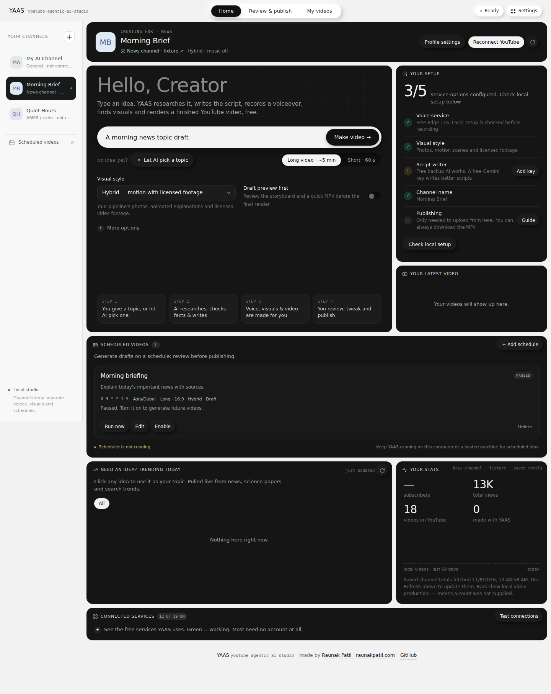
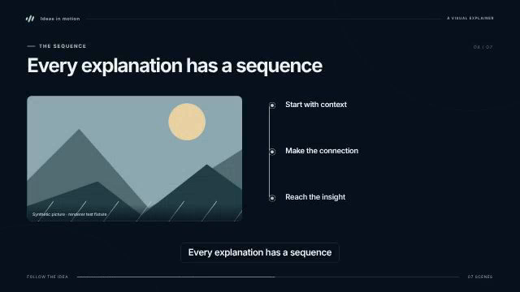
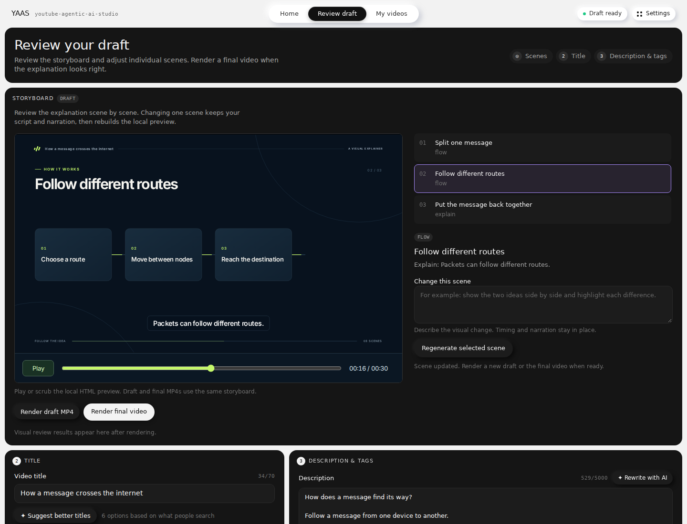
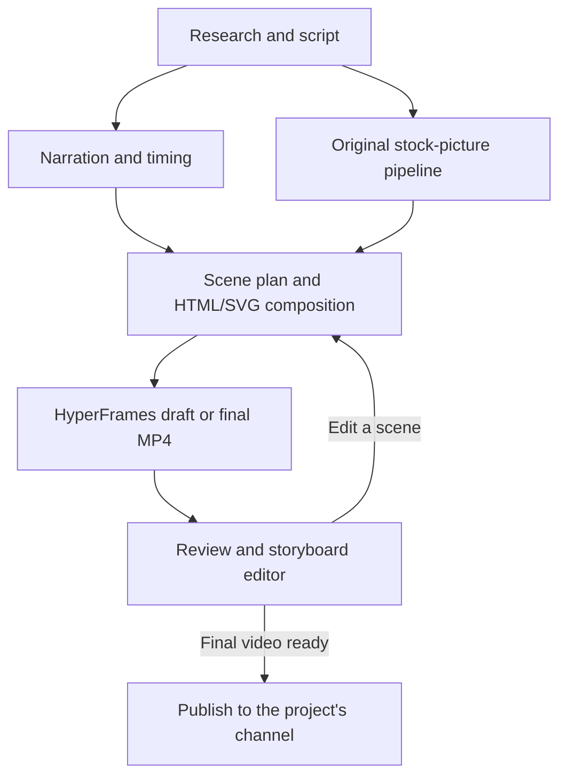

<div align="center">

# YAAS: Youtube Agentic Ai Studio

**Type an idea. Make a video you can review, edit and publish.**

YAAS gathers sources, writes the script, records narration, directs visuals and sound, renders the video, and helps you review and publish it from one local app.

[](https://python.org)
[](LICENSE)
[](SETUP.md)
[](https://github.com/raunakpatil/youtube-agentic-ai-studio/stargazers)

[**Quick start**](#-quick-start) · [**Channels & schedules**](docs/CHANNELS_AND_SCHEDULES.md) · [**Motion workflow**](docs/MOTION_STUDIO.md) · [**Setup guide**](SETUP.md) · [**FAQ**](#-faq)

[**Pipeline map**](docs/PIPELINE_ARCHITECTURE.md) · [**Purffle comparison**](docs/REPOSITORY_COMPARISON.md) · [**Agent capabilities and skills**](docs/AGENT_CAPABILITIES.md)

</div>

**Original YAAS demo (Classic workflow)**

https://github.com/user-attachments/assets/e94dab2d-3110-440c-b82e-b9289c0e6b51

---

## ⚡ Quick start

### Motion Studio and channel profiles

This fork adds **animated HTML/SVG scenes**, **separate YouTube channel profiles**,
and **recurring video generation**. These features are on this fork's **main** branch.

**Motion** creates animated diagrams, timelines, comparisons and text, without
fetching or automatically attaching stock pictures. **Hybrid** combines those
graphics with the original pipeline's pictures and optional Pexels video footage.
**Classic** keeps the MoviePy photo renderer.
Review the storyboard, change one scene, then render a draft or final MP4 with the
saved narration. Existing photo projects have an **Animate these photos** action:
it explicitly reuses their pictures and recording, and imports caption timing or labels a duration-based
estimate. A fresh voiceover is not mandatory. [Motion workflow](docs/MOTION_STUDIO.md).

Use the channel sidebar, or the selector on a small screen, for a News channel,
an ASMR/calm channel, and other profiles. Each keeps its own voice, music, visuals,
YouTube connection and schedules. Home shows the channel identity fetched after
you explicitly connect it. [Channels and schedules guide](docs/CHANNELS_AND_SCHEDULES.md).



*Example screen with sample channel names and a simulated YouTube identity; no
live account is shown. The schedule is paused in this demonstration.*

#### Rendered video samples

These are the final HyperFrames verification renders: **168 frames each**, lasting
**14 seconds at 12 fps**. Seven two-second scenes exercise text, flow, comparison,
timeline, chart, explanation and footage templates using the same renderer as
**Make video** and the storyboard's draft/final buttons.



**Landscape (16:9)** — [Watch or download the MP4](docs/samples/motion-landscape.mp4)

<details>
<summary><b>Portrait sample (9:16)</b></summary>

[Watch or download the portrait MP4](docs/samples/motion-portrait.mp4)

</details>

The landscape is **640×360** and the portrait is **360×640**. Both contain
**synthetic test-tone audio**, a generated picture, test-pattern footage and
illustrative chart values. They verify rendering, frame count and audio presence;
the tones are not a voice-quality demonstration. See [sample details and
reproduction commands](docs/samples/README.md).

These samples exercise the renderer's photo and footage support as well as its
graphics. New videos made with **Motion** use animated graphics by default.

#### Storyboard editor



The screenshot shows **YAAS → Review → Storyboard**, added by this fork. Its
interactive preview plays the same HTML/SVG composition that HyperFrames renders
into an MP4. Motion/Hybrid generation already uses HyperFrames during **Make video**;
this screen lets you inspect, edit and render that project again. The original
upstream YAAS renderer remains available as **Classic**.

#### Install and run

Install **Python 3.12**, **Node.js 22 or later**, and **FFmpeg with ffprobe** first.
Use a separate environment; the full app still contains the pinned legacy MoviePy stack.

Copy this fork's HTTPS clone URL from **Code → HTTPS** and replace
`REPOSITORY_URL` below with it. Clone its default **main** branch; no feature-branch
suffix or personal username is required in these instructions. The original
upstream repository has its own feature set.

**Windows PowerShell:**

```powershell
git clone REPOSITORY_URL yaas-motion
cd yaas-motion
py -3.12 -m venv .venv
.\.venv\Scripts\python.exe -m pip install --upgrade pip
.\.venv\Scripts\python.exe -m pip install -r requirements.txt
.\.venv\Scripts\python.exe -m pip check
npm ci --prefix renderers/hyperframes
node renderers/hyperframes/node_modules/hyperframes/bin/hyperframes.mjs browser ensure
$env:STUDIO_PORT = "8765"
.\.venv\Scripts\python.exe gui.py
```

**macOS / Linux:**

```bash
git clone REPOSITORY_URL yaas-motion
cd yaas-motion
python3.12 -m venv .venv
.venv/bin/python -m pip install --upgrade pip
.venv/bin/python -m pip install -r requirements.txt
.venv/bin/python -m pip check
npm ci --prefix renderers/hyperframes
node renderers/hyperframes/node_modules/hyperframes/bin/hyperframes.mjs browser ensure
.venv/bin/python gui.py
```

Open **Check local setup** on Home, choose or add a channel profile, then choose
**Motion** and **Draft preview first**. Enter a topic and press **Make video**.
Review → Storyboard lets you scrub the local HTML preview and regenerate one scene.
Each scene edit updates the preview and automatically renders a fresh draft MP4
on the same screen. In Hybrid or an explicitly photo-based project, **Use another
saved photo** swaps that scene's picture for another image already downloaded for
its section. Render the final video when ready. Try **Profile settings → Preview voice** before making
a long recording; it auditions the currently selected voice, speed and pitch.

YAAS restores the current local project when you restart it, including a valid
draft, its storyboard and recorded narration. Home distinguishes a playable draft
from a storyboard that still needs rendering. If saved files are incomplete or a
preview cannot load, Review explains the problem and offers a retry instead of
showing an empty screen. Choose **Make another video** on the completion card to
return to the topic form; an empty workspace shows that form automatically.
That action resets the pipeline steps for a fresh topic. Partial reruns reuse the
current project; enable **Research** to work on a new topic.
Starting a new project still replaces the working project;
the separate **My videos** archive keeps saved final videos and scheduled drafts.

For recurring videos, use **Home → Scheduled videos → Add schedule**. Choose a
topic, five-field cron expression and time zone. Schedules generate drafts or local
final MP4s; publishing still requires review and a separate action. Keep the app
running, or run `python gui.py --scheduler-only` with the same project environment.
Storing the source on GitHub does not run jobs by itself.

Visual planning can use the configured local/free text model, including Gemini
without an OpenRouter key. Without available inference, local art direction and
animated templates still work with an existing script and narration. The free router is
`openrouter/free`; explicit model choices are checked against the live catalogue.
Only free text output models are used for planning and optional frame review.
This does not provide a free generative video model or remove provider quotas.

Use **Python 3.10, 3.11 or 3.12**. Python 3.13+ isn't supported yet (the pinned `numpy<2` has no prebuilt wheels for it).

For new scripts, choose an installed local Ollama model or configure a free-tier
[Gemini](https://aistudio.google.com/apikey), Groq or OpenRouter account. Settings
can discover installed local models without downloading one. **Local only** never
falls through to hosted inference. Provider keys stay in local `.env`; hosted
quotas and account tiers still apply. YouTube upload is optional; download the
MP4 or follow the [Setup guide](SETUP.md) to connect a channel.

---

## 🧭 How it works

The app has three screens, in the order you use them:

| Screen | What you do there |
|---|---|
| **Home** | Select a channel, see its fetched YouTube identity, set up recurring generation, or make a video now. Motion/Hybrid runs HyperFrames during generation. Choose **Draft preview first** to inspect a first MP4 before the final render. |
| **Review & publish** | Watch the MP4 or inspect the storyboard. Edit a scene and render it again, or use **Animate these photos** on an older project. The saved project channel stays visible. Publish only after rendering a final video and verifying that channel's connection. |
| **My videos** | Videos are filtered by channel, with separate Long and Short sections and a Draft badge for scheduled previews. Reopen a project with its saved profile, pictures, narration and metadata. |

**Profile settings** holds each channel's voice, music and visual defaults.
**Settings** (top right) also exposes advanced options. Provider API keys are shared
by this local studio; YouTube sign-in tokens are separate for each profile.

The screenshots below show the original Classic workflow. The channel sidebar and
Motion storyboard extend that workflow.

<table>
<tr>
<td width="50%" align="center"><br><sub><b>Home</b>: type an idea, or let AI pick one</sub></td>
<td width="50%" align="center"><br><sub><b>Making a video</b>: plain-English progress, step by step</sub></td>
</tr>
<tr>
<td width="50%" align="center"><br><sub><b>Review &amp; publish</b>: watch, title, findability score</sub></td>
<td width="50%" align="center"><br><sub><b>Thumbnail styles</b>: pick Impact, Cinematic, Split or Studio</sub></td>
</tr>
</table>


### Where HyperFrames runs

The normal **Motion/Hybrid** pipeline is:



HyperFrames is the video-rendering stage. The Review screen previews the same
composition directly in the browser; scrubbing it does not encode another MP4.
Regenerating a scene refreshes its browser preview immediately and automatically
runs HyperFrames for a new draft MP4 with the saved narration and updated storyboard.
Review stays open, shows progress or an actionable error, and seeks the new MP4 to
the selected scene when ready. **Render draft MP4** retries the current storyboard;
**Render final video** encodes the final version. Scene edits invalidate the previous
final render. Your publishing metadata and existing thumbnail are preserved.

This fork adds the HyperFrames path while keeping the original picture acquisition
available in every mode. **Classic** renders those pictures and narration with
MoviePy. Old captions or audio-duration estimates can supply an explicitly labelled
timeline when a legacy project lacks measured timing metadata. Optional
OpenRouter frame review runs after rendering; it is separate from both the
renderer and the interactive Review screen.

### Channels, schedules and sound

Create a **News** profile for clear narration and Hybrid visuals, and an
**ASMR / calm** profile for slower speech and gentler photo movement. Presets are
editable starting points. News uses retrieved background sources and trend ideas;
it does not independently verify live breaking news. The calm preset adjusts the
script and voice; it does not synthesize binaural recordings or authentic ASMR triggers.

**Automatic sound design** is the default for new profiles. The agent chooses
music, relevant ambience and sparse effects itself, using the script and measured
narration. It can search Wikimedia Commons without a key and keeps complete
source/license information. You do not need to import or choose every track.
News omits transient effects; ASMR uses calmer choices. Unavailable or unsuitable
recordings are omitted with a visible explanation, not replaced by synthetic tones.

**Review → Music & effects → Regenerate sound design** rebuilds the soundtrack
and draft while keeping the original voice, storyboard and publishing prose.
Review shows actual layers, cue times and measured loudness/peak results.
Normal/news finishing targets −16 LUFS; ASMR targets −20 LUFS with a smaller
gain bound. Peak headroom can prevent a target from being reached, and the report
says so. Audio is lossless PCM before MP4 encoding. A cancelled rebuild keeps
the previous committed soundtrack and credits.

**Manual** remains available for an exact saved track or local folder. Existing
enabled imported selections stay Manual on upgrade; select Automatic explicitly
to hand those decisions to the agent. **Off** removes added sound layers. A legacy
music switch with an empty folder cannot create music by itself.

**Pixabay music and sound effects:** YAAS uses Pixabay's API for pictures.
Pixabay's [public API documentation](https://pixabay.com/api/docs/) provides image
and video endpoints, but no documented music or sound-effect endpoint. To use its
audio as an optional Manual source, download a track and import the file into YAAS:

1. Select the channel in the sidebar, then open **Settings → Audio library**.
2. Choose **Music** or **Sound effect**, select the downloaded file, and click
   **Import audio**. MP3, WAV, OGG, M4A and FLAC are supported, up to 20 MiB and two
   hours per file. The optional source URL, creator, license note and Content ID
   status stay with the imported track.
3. Select **Manual** sound design, preview the track, choose it under **Music track** or **Effect track**, enable
   that layer and save Settings. **Transitions** plays an effect briefly between
   script sections; **Ambience** loops it beneath the narration for calm or ASMR
   projects. Each channel keeps its own library and selections.
4. New videos use the saved choices. For an existing Motion or Hybrid draft, open
   **Review → Music & effects → Apply music & effects to current draft**. This
   rebuilds the soundtrack and preview using the current script, recorded voice
   and storyboard. For Classic, clear the topic on Home and select only **Music**
   and **Render** under More options.

The existing per-channel music-folder option still works. Selecting an imported
music track uses that exact track. Audio sources actually applied to the project
appear in Review and are retained with archived videos; generated descriptions
include their source details. Applying audio preserves an edited description's
prose and refreshes only its marked audio-credit block; required credits are never silently truncated.
Pixabay notes that some tracks are registered with YouTube Content ID and can
receive claims; keep the download's source details and any available certificate.
See [Pixabay's FAQ](https://pixabay.com/service/faq/) for its current guidance.

Schedules use a persistent queue and run one generation job at a time. Automatic
slots missed by more than 15 minutes, including expired queued slots, are skipped;
an interrupted job is not retried automatically. A scheduled run uses separate
working files, archives its draft or final result, and restores the open editor.
See [the schedule lifecycle and hosting instructions](docs/CHANNELS_AND_SCHEDULES.md).

---

## ✨ Features

| | |
|---|---|
| 🧠 **Trend-aware topics** | Live ideas from Google Trends, Wikipedia, Hacker News, Spaceflight News and arXiv. Click one, or let the AI ride a trend that fits your niche. |
| 📚 **Source-grounded writing** | Retrieved Wikipedia/arXiv background and retained source links. Editorial checks cover writing quality; they do not verify facts or predict views. News receives suggestions without automatic factual rewrites. |
| ✍️ **Local/free inference** | Installed local Ollama, or configured free-tier Gemini/Groq/OpenRouter. Local-only never falls back to cloud. Missing quota produces an honest error or supported local fallback. |
| 🖼️ **Stock and local graphics** | Pexels/Pixabay when configured, NASA space imagery and credited Openverse pictures. Graphics-only Motion does not fetch or reuse pictures. |
| 🎙️ **Voice audition** | Preview an Edge neural voice with your unsaved speed and pitch before recording. Fresh narration stores measured section timing and available word events; legacy recordings can reuse captions or clearly labelled timing estimates. |
| 🎞️ **Motion / Hybrid / Classic** | Motion creates explanatory graphics with five art directions and varied supported compositions; Hybrid adds current project photos/footage; Classic retains the original photo renderer. Explicit old-photo reuse remains available. All support 16:9 or 9:16. |
| 🎛️ **Editable storyboard** | Scrub the local HTML preview, regenerate one scene and render a draft or final MP4 from the same plan. Full projects, narration, timing, media and credits are archived for reopening. |
| 👁️ **Optional visual review** | An explicitly enabled free vision model checks a few rendered frames for visible layout problems. Review is advisory and does not certify factual accuracy. |
| 🏷️ **Your brand** | Your channel name appears in the intro, on Shorts and on thumbnails. Change the text or switch it off in Settings. |
| 📺 **Channel profiles** | Sidebar/mobile selector, fetched YouTube identity, separate sign-ins, channel-bound projects, and editable General, News and ASMR/calm defaults. |
| ✦ **Title Lab** | 6 alternative titles written from what people actually search, each scored. |
| 🔎 **Findability score** | 11 checks based on YouTube best practice (length, keyword placement, chapters, tags, hashtags, call to action), each with a tip. |
| 🔤 **Keyword ideas** | Real YouTube autocomplete suggestions + related terms, one click to add as tags. |
| 🖌️ **Thumbnail designer** | 4 local styles (Impact, Cinematic, Split, Studio), explicit style previews, AI text ideas and saved project-photo backgrounds. Opening Review does not regenerate thumbnails. |
| ⏱️ **Scheduled generation** | Per-channel cron and IANA time zone, at least 15 minutes between a schedule's automatic occurrences, persistent queue, draft archives and manual Run now. Keep YAAS running; generated videos wait for review. |
| 📅 **Publish after review** | Upload a final video now or choose its YouTube publication time. This remains separate from recurring generation. Downloads for MP4, thumbnail and captions (SRT). |
| 📊 **Your stats** | Production history, plus live subscribers and views per upload with a free YouTube Data API key. |
| 🗂️ **My videos** | Every render archived with its script, sources, photos and metadata. |
| ©️ **Credits** | Every video carries a semi-transparent **raunakpatil.com** watermark, and descriptions end with *Made with YAAS by Raunak Patil · raunakpatil.com*. |
| 🎵 **Automatic sound direction** | The agent chooses suitable licensed music/ambience and sparse effects, with measured cue timing, speech ducking, fades and finishing. Manual choices remain optional. Review reports the audio actually applied and why a layer was omitted. |
| 🔤 **Measured word captions** | Highlight available verified speech word events, use phrase captions for imported/estimated timing, or choose Plain/Off. |
| ♻️ **Narration reuse** | Unchanged sections reuse validated audio/caption/timing bundles; changed text or voice settings produces a new recording. |

---

## 🔌 The free API stack

Local models and the listed services support a route without paid inference.
Hosted free tiers have quotas and depend on the selected account; an API key does
not itself prove that an account has billing disabled. Keyless services can also
be unavailable or limited. The app does not silently substitute a paid model.

| Service | Used for | Key |
|---|---|---|
| Google Gemini | Research, scripts, titles | free key, recommended |
| Groq | Fast backup AI | free key, optional |
| OpenRouter | Free text planning, backup AI and optional vision review | free key, optional; quotas apply |
| Local Ollama | Writing, sound and text visual direction | installed local model; no cloud fallback in Local-only |
| Edge TTS | Neural voiceover | keyless |
| Pexels | Stock photos and real video clips in Hybrid mode | free key, optional |
| Pixabay | Stock photos | free key, optional |
| NASA Image Library | Public-domain space imagery | keyless |
| Openverse | Creative Commons images (credited) | keyless |
| Wikimedia Commons | Automatic licensed music and sound recordings | keyless; suitable licensed match required |
| Wikipedia | Background sources + trending ideas | keyless |
| arXiv | Research background + topic ideas | keyless |
| Google Trends RSS | Search spikes | keyless |
| Hacker News (Algolia) | Tech trends | keyless |
| Spaceflight News API | Space & science news | keyless |
| YouTube autocomplete | Keyword research | keyless |
| Datamuse | Related keywords | keyless |
| YouTube Data API | Channel stats | free key, optional |
| YouTube upload (OAuth) | Publishing | one-time setup |

Home → **Connected services → Test connections** pings every service and shows what's working.

> The retired unauthenticated Pollinations text/image routes are no longer advertised or called for generation. A provider failure is reported; rendering a saved plan needs no fresh inference.

---

## 🔑 Keys and settings

Provider keys entered in **Settings** live in `.env` (git-ignored) and are shared by
the local studio. Process environment variables also work. Either paste the keys
in **Settings** or copy `.env.example`:

```bash
cp .env.example .env
```

The original default profile keeps its compatible settings in `settings.json`.
Additional profiles and fetched channel metadata live in `.yaas/channels.json`;
schedules and queued jobs live in `.yaas/schedules.sqlite3`. These files are
git-ignored. The defaults live in `config.py`.

YouTube tokens are separate: the default profile can keep the legacy
`youtube_token.json`, while additional profiles use
`.yaas/channels/<profile-id>/youtube_token.json`. A saved project keeps its profile
ID. Reconnecting a verified profile to a different YouTube channel is blocked;
create another profile for that channel. Back up the local data and `output/library/`
if you move the studio to another machine. [Storage and migration details](docs/CHANNELS_AND_SCHEDULES.md#local-storage-and-backups).

---

## 📁 Project structure

```
├── gui.py                  ← run this: starts the app (Flask, http://localhost:7070)
├── config.py               ← every default, documented (+ .env / settings.json loaders)
├── .env.example            ← copy to .env for your keys
│
├── apis/                   ← free API integrations (all fail-soft)
│   ├── trends.py           ← Google Trends, Wikipedia, HN, Spaceflight News, arXiv
│   ├── knowledge.py        ← Wikipedia + arXiv fact grounding
│   ├── seo.py              ← YouTube autocomplete, Datamuse, findability score
│   ├── images.py           ← Pixabay, NASA, Openverse
│   ├── llm.py              ← configured free hosted fallback
│   ├── local_llm.py        ← installed local Ollama models only
│   ├── audio_sources.py    ← licensed Commons audio acquisition
│   └── youtube_stats.py    ← public channel stats
│
├── agents/
│   ├── gemini_client.py    ← Gemini model chain + fallback hand-off
│   ├── json_utils.py       ← repairs broken JSON from models
│   ├── researcher.py       ← topic research (trend-aware, grounded)
│   └── scriptwriter.py     ← script writing
│
├── video/
│   ├── narrator.py         ← Edge TTS voiceover + captions
│   ├── stock.py            ← image download chain + credits
│   ├── creator.py          ← renderer (Ken Burns, captions, Shorts, watermark)
│   ├── thumbnail.py        ← thumbnail designer (4 styles, 16:9 + 9:16)
│   ├── fonts.py            ← Google Fonts download + fallbacks
│   └── music.py            ← background music mixer
│
├── uploader/youtube.py     ← YouTube sign-in + upload
├── studio/                 ← the app behind gui.py
│   ├── pipeline.py         ← blueprint: run / stop, live progress, status
│   ├── review.py           ← blueprint: description, thumbnail designer, Title Lab + SEO
│   ├── library.py          ← blueprint: saved videos
│   ├── channels.py         ← profiles, fetched channel identities, isolated tokens
│   ├── schedules.py        ← persistent queue and recurring generation
│   ├── audio.py            ← explicit voice-preview endpoint
│   ├── upload.py           ← blueprint: YouTube publishing
│   ├── settings.py         ← blueprint: keys + settings
│   ├── dashboard.py        ← blueprint: trends, channel stats, API health
│   ├── runner.py           ← the pipeline thread
│   ├── state.py            ← the current video + live log
│   ├── security.py         ← localhost-only guard
│   ├── templates/index.html← the page
│   └── static/             ← app.css + js/ (one file per screen)
├── tests/                  ← pytest suite (offline, no keys needed)
├── docs/                   ← motion/channel guides, samples and README images
├── .yaas/                  ← local profiles, tokens and queue (git-ignored)
└── output/                 ← generated files (git-ignored)
    └── library/            ← every finished video, archived
```

---

## 🧪 Running the tests

```bash
python -m pip install pytest
python -m pytest -q
```

The Python suite runs offline without API keys. It covers measured and imported
legacy timing, profile/token isolation, verified publishing, schedule validation,
queue recovery, audio mixing, scene planning, preview isolation and project reopening.
Scheduling uses `croniter==6.2.4` and `tzdata>=2025.2` from `requirements.txt`.
Browser checks cover channel switching, schedules, explicit voice preview, narrow
layouts and legacy photo conversion as well as the renderer. See
[Motion Studio verification](docs/MOTION_STUDIO.md#verification) for browser tests
and real HyperFrames MP4 smoke renders in both orientations.

---

## ❓ FAQ

<details>
<summary><b>Does this cost anything?</b></summary>

No subscription is required by YAAS. Use an installed local Ollama model or a
hosted account that still has free-tier access and quota. Local rendering and
inference use your own hardware; a provider API key by itself does not guarantee
that the provider will not bill your account. OpenRouter selection is restricted
to its free router or verified free models.
</details>

<details>
<summary><b>Do I need any API keys?</b></summary>

New writing needs an installed local Ollama model or an available free-tier hosted key. Local graphics and saved-project rendering need neither. NASA/Openverse and Commons sources are keyless, but network availability and suitable results are not guaranteed.
</details>

<details>
<summary><b>How long does one video take?</b></summary>

Time depends on model latency, narration length, hardware and render settings. Preview a short draft on your machine before scheduling long videos; no fixed speed is guaranteed.
</details>

<details>
<summary><b>The voiceover step fails with a 403 error</b></summary>

Microsoft periodically changes its free speech service. Update the voice library: `pip install -U edge-tts`.
</details>

<details>
<summary><b>Can I use it without uploading to YouTube?</b></summary>

Yes. Download the MP4, thumbnail and captions from **Review & publish** and upload them however you like.
</details>

<details>
<summary><b>Can I turn off the raunakpatil.com watermark?</b></summary>

No. The small semi-transparent watermark is part of every video YAAS renders, as credit for the free tool. The description credit line can be switched off in **Settings → Publishing**.
</details>

<details>
<summary><b>Why is moviepy pinned to 1.0.3?</b></summary>

MoviePy 2.x removed `moviepy.editor` and changed the API, and NumPy must stay below 2.0 for it. Don't upgrade either.
</details>

<details>
<summary><b>The video has tiny or ugly text</b></summary>

Your system is missing the fonts the renderer looks for. Install DejaVu (`sudo apt install fonts-dejavu` on Ubuntu). Windows already has them.
</details>

<details>
<summary><b>YouTube upload fails with "access denied"</b></summary>

Select the video's profile on Home and use **Reconnect YouTube**. Make sure your
Google account is a **Test user** on your OAuth consent screen. Choose the same
channel already bound to that profile; use a new profile for another channel.
The app checks the authenticated channel again before uploading.
</details>

<details>
<summary><b>Why does an older Motion draft still contain photos?</b></summary>

Earlier versions automatically attached saved pictures to Motion scenes. Opening
that draft preserves its saved composition. Choose **Rebuild as Motion graphics**
in Review to rebuild its visuals with the existing script and recording. New
Motion videos use animated graphics by default; **Animate these photos** is the
explicit option for keeping a photo-based composition.
</details>

<details>
<summary><b>Do I have to record old narration again for Motion?</b></summary>

No. Open the saved photo project and choose **Animate these photos**. YAAS reuses
the recording, imports existing SRT cues when possible, or estimates section timing
from the audio duration and labels it. If only the old MP4 remains, its soundtrack
can be recovered, including any music already mixed into it. That music cannot be
isolated from the recording. Fresh narration is useful when you change the spoken
script or want the speech service's word timing events, when available.
</details>

<details>
<summary><b>Do GitHub or cron expressions run videos while my computer is off?</b></summary>

No. Keep `python gui.py` running, or use `python gui.py --scheduler-only` on an
always-on machine with this project's dependencies, configuration and media.
The GitHub repository stores source and CI; it is not a running studio. Automatic
slots older than 15 minutes are skipped, and interrupted runs require a manual
retry. Recurring generation does not publish to YouTube.
</details>

<details>
<summary><b>Why did an earlier link contain /tree/feat/motion-studio?</b></summary>

That URL opened a development branch on GitHub. These enhancements are now on
this fork's **main** branch, so use the repository's normal root page and clone
command. The branch URL never represented a running cloud application.
</details>

---

## 🗺️ Roadmap

- [x] Thumbnail designer (4 styles, AI text ideas, AI artwork)
- [x] Scheduled uploads
- [x] Analytics (channel stats + production history)
- [x] Trend-aware topics and fact-checked scripts
- [x] Stock video B-roll (Pexels in Hybrid mode)
- [x] Multi-channel profiles and verified publishing identity
- [x] Per-channel recurring generation with a persistent queue
- [x] Explicitly animate saved photos and reuse their narration
- [x] Voice preview and quieter optional music mixing
- [ ] Custom intro/outro clips
- [ ] Caption upload to YouTube

---

## 🎬 Made with YAAS

**[Eldritch Lore](https://www.youtube.com/@EldritchLore)** runs on this pipeline: science, history and "what if" videos.

## 🤝 Contributing

Pull requests welcome. Open an issue first for big changes. See [CONTRIBUTING.md](CONTRIBUTING.md).

<div align="center">

Made by <a href="https://raunakpatil.com">Raunak Patil</a> · UI styled after <a href="https://raunakpatil.com">raunakpatil.com</a>

</div>
