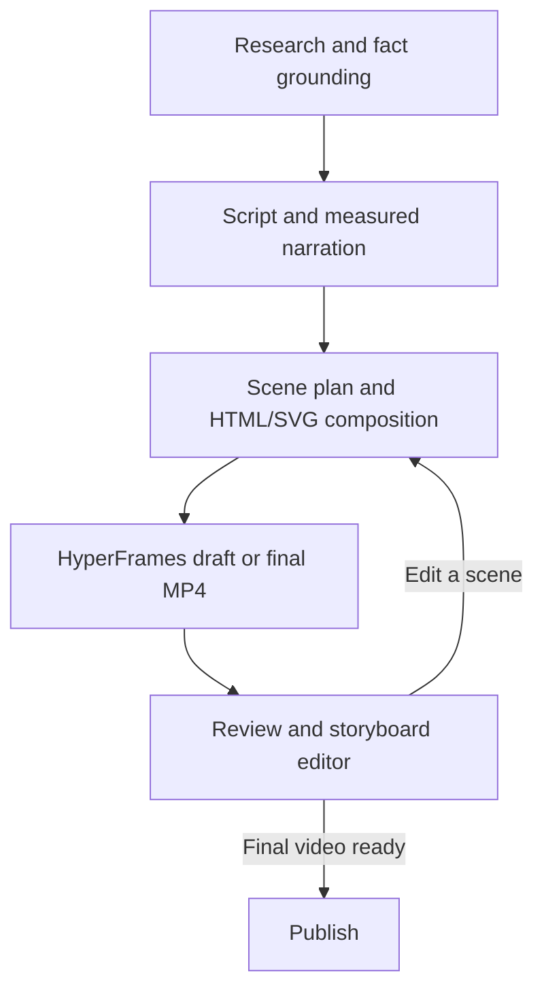

<div align="center">


# YAAS: Youtube Agentic Ai Studio

**Type an idea. Get a finished, fact-checked YouTube video. Free.**

YAAS researches a topic, checks the facts, writes the script, records a voiceover, finds visuals, renders the video, and helps you title, tag and publish it, all from one simple local app.

[](https://python.org)
[](LICENSE)
[](SETUP.md)
[](#-the-free-api-stack)
[](https://github.com/raunakpatil/youtube-agentic-ai-studio/actions/workflows/tests.yml)
[](https://github.com/raunakpatil/youtube-agentic-ai-studio/stargazers)

[**Quick start**](#-quick-start) · [**How it works**](#-how-it-works) · [**Free APIs**](#-the-free-api-stack) · [**Setup guide**](SETUP.md) · [**FAQ**](#-faq)

</div>

**Original YAAS demo (Classic workflow)**

https://github.com/user-attachments/assets/e94dab2d-3110-440c-b82e-b9289c0e6b51

---

## ⚡ Quick start

### Motion Studio fork

This fork adds **animated HTML/SVG scenes** synchronized to measured narration.
Choose **Motion** for diagrams, timelines, comparisons, charts and kinetic text;
**Hybrid** adds real Pexels video footage. **Classic** keeps the original photo renderer.
Review the storyboard, change one scene, then render a draft or final MP4 without
recording the voice again. [Motion workflow and architecture](docs/MOTION_STUDIO.md).

#### Rendered video samples

These are actual **14-second HyperFrames MP4s** from the renderer used by
**Make video** and the storyboard's draft/final buttons. They show all seven
templates: kinetic text, flow, comparison, timeline, chart, explainer and footage.

**Landscape (16:9)** — [Watch or download the MP4](docs/samples/motion-landscape.mp4)

https://github.com/user-attachments/assets/479bc47c-e349-461b-b3b6-97b20a55628c

<details>
<summary><b>Portrait sample (9:16)</b></summary>

https://github.com/user-attachments/assets/1b71f0e6-3086-4726-a168-bb2bede6f185

[Watch or download the portrait MP4](docs/samples/motion-portrait.mp4)

</details>

These small renderer demos use synthetic tone audio, labelled synthetic chart
values and a moving test-pattern clip. They are draft-resolution samples
(640×360 and 360×640 at 12 fps), not finished narrated videos. To reproduce them,
see [the renderer verification commands](docs/MOTION_STUDIO.md#verification).

#### Storyboard editor


The screenshot shows **YAAS → Review → Storyboard**, added by this fork. Its
interactive preview plays the same HTML/SVG composition that HyperFrames renders
into an MP4. Motion/Hybrid generation already uses HyperFrames during **Make video**;
this screen lets you inspect, edit and render that project again. The original
upstream YAAS renderer remains available as **Classic**.

#### Install and run

Install **Python 3.12**, **Node.js 22 or later**, and **FFmpeg with ffprobe** first.
Use a separate environment; the full app still contains the pinned legacy MoviePy stack.

Copy this repository's HTTPS clone URL from **Code → HTTPS** and replace
`REPOSITORY_URL` below with it. Use a repository containing the `feat/motion-studio`
branch; the original upstream repository does not include these changes.

**Windows PowerShell:**

```powershell
git clone --branch feat/motion-studio REPOSITORY_URL yaas-motion
cd yaas-motion
py -3.12 -m venv .venv
.\.venv\Scripts\python.exe -m pip install --upgrade pip
.\.venv\Scripts\python.exe -m pip install -r requirements.txt
.\.venv\Scripts\python.exe -m pip check
npm ci --prefix renderers/hyperframes
node renderers/hyperframes/node_modules/hyperframes/bin/hyperframes.mjs browser ensure
$env:STUDIO_PORT = "8765"
.\.venv\Scripts\python.exe gui.py
```

**macOS / Linux:**

```bash
git clone --branch feat/motion-studio REPOSITORY_URL yaas-motion
cd yaas-motion
python3.12 -m venv .venv
.venv/bin/python -m pip install -r requirements.txt
npm ci --prefix renderers/hyperframes
node renderers/hyperframes/node_modules/hyperframes/bin/hyperframes.mjs browser ensure
.venv/bin/python gui.py
```

Open **Check setup** on Home, choose **Motion** and **Draft preview**, enter a topic,
then press **Make video**. Review → Storyboard lets you scrub the local HTML preview,
regenerate an individual scene and render the final video.

An OpenRouter key is optional for visual planning. Without one, local animated
templates still work with an existing script and narration. The free router is
`openrouter/free`; explicit model choices are checked against the live catalogue.
Only free text output models are used for planning and optional frame review.
This does not provide a free generative video model or remove provider quotas.

Use **Python 3.10, 3.11 or 3.12**. Python 3.13+ isn't supported yet (the pinned `numpy<2` has no prebuilt wheels for it).

No keys are required to try it. A free [Gemini key](https://aistudio.google.com/apikey) (1 minute to get) makes the scripts much better. Paste it in **Settings** and it's stored locally in `.env`. Uploading straight to YouTube needs a one-time Google setup, covered in the [Setup guide](SETUP.md). You can always download the MP4 and upload it yourself instead.

---

## 🧭 How it works

The app has three screens, in the order you use them:

| Screen | What you do there |
|---|---|
| **Home** | Type a topic, choose a long video or Short, then select Motion, Hybrid or Classic. **Make video** runs the generation pipeline, including HyperFrames rendering for Motion/Hybrid. Choose **Draft preview** to inspect an initial MP4 before the final render. |
| **Review & publish** | Watch the MP4 or inspect the live storyboard. In Motion/Hybrid, edit one scene and render a draft or final video from the updated composition. Then polish the title, description, tags and thumbnail before uploading or scheduling. |
| **My videos** | Every finished video is saved automatically, with **Long videos** and **Shorts** in separate sections. Re-open, re-edit, re-publish, download or delete. |

**Settings** (top right) holds your channel name, voice, optional keys and advanced options. Everything has a sensible default.

<table>
<tr>
<td width="50%" align="center"><br><sub><b>Home</b>: type an idea, or let AI pick one</sub></td>
<td width="50%" align="center"><br><sub><b>Making a video</b>: plain-English progress, step by step</sub></td>
</tr>
<tr>
<td width="50%" align="center"><br><sub><b>Review &amp; publish</b>: watch, title, findability score</sub></td>
<td width="50%" align="center"><br><sub><b>Thumbnail styles</b>: pick Impact, Cinematic, Split or Studio</sub></td>
</tr>
</table>


### Where HyperFrames runs

The normal **Motion/Hybrid** pipeline is:



HyperFrames is the video-rendering stage. The Review screen previews the same
composition directly in the browser; scrubbing it does not encode another MP4.
After a scene edit, **Render draft MP4** or **Render final video** runs HyperFrames
again with the saved narration and updated storyboard. Changing a scene invalidates
the previous MP4 until it is rendered again.

This fork adds the HyperFrames path. **Classic** continues to use the original
upstream pipeline: stock photos, narration and MoviePy rendering. Optional
OpenRouter frame review runs after rendering; it is separate from both the
renderer and the interactive Review screen.

---

## ✨ Features

| | |
|---|---|
| 🧠 **Trend-aware topics** | Live ideas from Google Trends, Wikipedia, Hacker News, Spaceflight News and arXiv. Click one, or let the AI ride a trend that fits your niche. |
| 📚 **Fact-checked scripts** | Before writing, YAAS pulls background from Wikipedia and arXiv, tells the AI not to contradict it, and lists the sources in your description. |
| ✍️ **Never-stuck AI** | Gemini model chain → Groq → OpenRouter → Pollinations (keyless), so a quota error doesn't kill the run. Broken JSON from models is repaired automatically. |
| 🖼️ **Visuals without a key** | Pexels → Pixabay → NASA (public domain, space topics) → Openverse (CC, credited) → AI-generated images. Credits are written into the description for you. |
| 🎙️ **Free voice** | Microsoft Edge neural voices with word-synced captions. |
| 🎞️ **Motion / Hybrid / Classic** | HTML/SVG motion templates and real stock video in 16:9 or 9:16, with the original photo renderer retained as Classic. Measured narration drives scene boundaries and chapters. |
| 🎛️ **Editable storyboard** | Scrub the local HTML preview, regenerate one scene and render a draft or final MP4 from the same plan. Full projects, narration, timing, media and credits are archived for reopening. |
| 👁️ **Optional visual review** | An explicitly enabled free vision model checks a few rendered frames for visible layout problems. Review is advisory and does not certify factual accuracy. |
| 🏷️ **Your brand** | Your channel name appears in the intro, on Shorts and on thumbnails. Change the text or switch it off in Settings. |
| ✦ **Title Lab** | 6 alternative titles written from what people actually search, each scored. |
| 🔎 **Findability score** | 11 checks based on YouTube best practice (length, keyword placement, chapters, tags, hashtags, call to action), each with a tip. |
| 🔤 **Keyword ideas** | Real YouTube autocomplete suggestions + related terms, one click to add as tags. |
| 🖌️ **Thumbnail designer** | 4 styles (Impact, Cinematic, Split, Studio) with live previews, short punchy text with a highlighted word, AI text ideas, and any photo from the video or brand-new AI artwork as the background. 1280×720 for long videos, 1080×1920 for Shorts, always under YouTube's 2 MB limit. |
| 📅 **Schedule uploads** | Upload now or pick a time. Downloads for MP4, thumbnail and captions (SRT). |
| 📊 **Your stats** | Production history, plus live subscribers and views per upload with a free YouTube Data API key. |
| 🗂️ **My videos** | Every render archived with its script, sources, photos and metadata. |
| ©️ **Credits** | Every video carries a semi-transparent **raunakpatil.com** watermark, and descriptions end with *Made with YAAS by Raunak Patil · raunakpatil.com*. |
| 🎵 **Background music** | Drop MP3s in `music library/` and they're shuffled and looped to fit. |

---

## 🔌 The free API stack

Everything below is free. **Keyless** ones work out of the box; the others need a free sign-up and are optional.

| Service | Used for | Key |
|---|---|---|
| Google Gemini | Research, scripts, titles | free key, recommended |
| Groq | Fast backup AI | free key, optional |
| OpenRouter | Free text planning, backup AI and optional vision review | free key, optional; quotas apply |
| Pollinations (text) | Last-resort backup AI | keyless |
| Edge TTS | Neural voiceover | keyless |
| Pexels | Stock photos and real video clips in Hybrid mode | free key, optional |
| Pixabay | Stock photos | free key, optional |
| NASA Image Library | Public-domain space imagery | keyless |
| Openverse | Creative Commons images (credited) | keyless |
| Pollinations (image) | AI B-roll & thumbnail art | keyless |
| Wikipedia | Fact-checking + trending ideas | keyless |
| arXiv | Fact-checking + new research ideas | keyless |
| Google Trends RSS | Search spikes | keyless |
| Hacker News (Algolia) | Tech trends | keyless |
| Spaceflight News API | Space & science news | keyless |
| YouTube autocomplete | Keyword research | keyless |
| Datamuse | Related keywords | keyless |
| YouTube Data API | Channel stats | free key, optional |
| YouTube upload (OAuth) | Publishing | one-time setup |

Home → **Connected services → Test connections** pings every service and shows what's working.

> Free, keyless services can rate-limit or change without notice. YAAS retries, then falls through to the next source, and the run only fails if every option for a step is down.

---

## 🔑 Keys and settings

Keys live in `.env` (git-ignored) and nothing else stores them. Either paste them in **Settings** or copy `.env.example`:

```bash
cp .env.example .env
```

Non-secret settings (voice, channel description, video style) are saved to `settings.json` (git-ignored), so `git pull` never clashes with them. The defaults live in `config.py`, documented line by line.

---

## 📁 Project structure

```
├── gui.py                  ← run this: starts the app (Flask, http://localhost:7070)
├── config.py               ← every default, documented (+ .env / settings.json loaders)
├── .env.example            ← copy to .env for your keys
│
├── apis/                   ← free API integrations (all fail-soft)
│   ├── trends.py           ← Google Trends, Wikipedia, HN, Spaceflight News, arXiv
│   ├── knowledge.py        ← Wikipedia + arXiv fact grounding
│   ├── seo.py              ← YouTube autocomplete, Datamuse, findability score
│   ├── images.py           ← Pixabay, NASA, Openverse, Pollinations
│   ├── llm.py              ← Groq → OpenRouter → Pollinations fallback
│   └── youtube_stats.py    ← public channel stats
│
├── agents/
│   ├── gemini_client.py    ← Gemini model chain + fallback hand-off
│   ├── json_utils.py       ← repairs broken JSON from models
│   ├── researcher.py       ← topic research (trend-aware, grounded)
│   └── scriptwriter.py     ← script writing
│
├── video/
│   ├── narrator.py         ← Edge TTS voiceover + captions
│   ├── stock.py            ← image download chain + credits
│   ├── creator.py          ← renderer (Ken Burns, captions, Shorts, watermark)
│   ├── thumbnail.py        ← thumbnail designer (4 styles, 16:9 + 9:16)
│   ├── fonts.py            ← Google Fonts download + fallbacks
│   └── music.py            ← background music mixer
│
├── uploader/youtube.py     ← YouTube sign-in + upload
├── studio/                 ← the app behind gui.py
│   ├── pipeline.py         ← blueprint: run / stop, live progress, status
│   ├── review.py           ← blueprint: description, thumbnail designer, Title Lab + SEO
│   ├── library.py          ← blueprint: saved videos
│   ├── upload.py           ← blueprint: YouTube publishing
│   ├── settings.py         ← blueprint: keys + settings
│   ├── dashboard.py        ← blueprint: trends, channel stats, API health
│   ├── runner.py           ← the pipeline thread
│   ├── state.py            ← the current video + live log
│   ├── security.py         ← localhost-only guard
│   ├── templates/index.html← the page
│   └── static/             ← app.css + js/ (one file per screen)
├── tests/                  ← pytest suite (offline, no keys needed)
├── docs/screenshots/       ← README images
└── output/                 ← generated files (git-ignored)
    └── library/            ← every finished video, archived
```

---

## 🧪 Running the tests

```bash
python -m pip install pytest
python -m pytest -q
```

The Python suite runs offline without API keys. It covers the original app plus
measured audio, stale-cache rejection, free model selection, scene planning,
preview isolation, project reopening and renderer cancellation. See
[Motion Studio verification](docs/MOTION_STUDIO.md#verification) for browser tests
and real HyperFrames MP4 smoke renders in both orientations.

---

## ❓ FAQ

<details>
<summary><b>Does this cost anything?</b></summary>

No. Every service has a free tier or needs no account, and rendering runs on your own machine.
</details>

<details>
<summary><b>Do I need any API keys?</b></summary>

Not to try it. Without keys, scripts come from the keyless backup AI and visuals from NASA / Openverse / AI images. A free Gemini key is strongly recommended for script quality and reliability.
</details>

<details>
<summary><b>How long does one video take?</b></summary>

Research and script take under a minute. A Short renders in a few minutes; a 6–8 minute video in roughly 3–10 minutes depending on your CPU and the *Render quality* setting.
</details>

<details>
<summary><b>The voiceover step fails with a 403 error</b></summary>

Microsoft periodically changes its free speech service. Update the voice library: `pip install -U edge-tts`.
</details>

<details>
<summary><b>Can I use it without uploading to YouTube?</b></summary>

Yes. Download the MP4, thumbnail and captions from **Review & publish** and upload them however you like.
</details>

<details>
<summary><b>Can I turn off the raunakpatil.com watermark?</b></summary>

No. The small semi-transparent watermark is part of every video YAAS renders, as credit for the free tool. The description credit line can be switched off in **Settings → Music & publishing**.
</details>

<details>
<summary><b>Why is moviepy pinned to 1.0.3?</b></summary>

MoviePy 2.x removed `moviepy.editor` and changed the API, and NumPy must stay below 2.0 for it. Don't upgrade either.
</details>

<details>
<summary><b>The video has tiny or ugly text</b></summary>

Your system is missing the fonts the renderer looks for. Install DejaVu (`sudo apt install fonts-dejavu` on Ubuntu). Windows already has them.
</details>

<details>
<summary><b>YouTube upload fails with "access denied"</b></summary>

Delete `youtube_token.json` and upload again to redo sign-in. Make sure your Google account is a **Test user** on the OAuth consent screen.
</details>

---

## 🗺️ Roadmap

- [x] Thumbnail designer (4 styles, AI text ideas, AI artwork)
- [x] Scheduled uploads
- [x] Analytics (channel stats + production history)
- [x] Trend-aware topics and fact-checked scripts
- [ ] Stock video B-roll (Pexels / Pixabay video)
- [ ] Multi-channel profiles
- [ ] Custom intro/outro clips
- [ ] Caption upload to YouTube

---

## 🎬 Made with YAAS

**[Eldritch Lore](https://www.youtube.com/@EldritchLore)** runs on this pipeline: science, history and "what if" videos.

## 🤝 Contributing

Pull requests welcome. Open an issue first for big changes. See [CONTRIBUTING.md](CONTRIBUTING.md).

<div align="center">

Made by <a href="https://raunakpatil.com">Raunak Patil</a> · UI styled after <a href="https://raunakpatil.com">raunakpatil.com</a>

</div>
