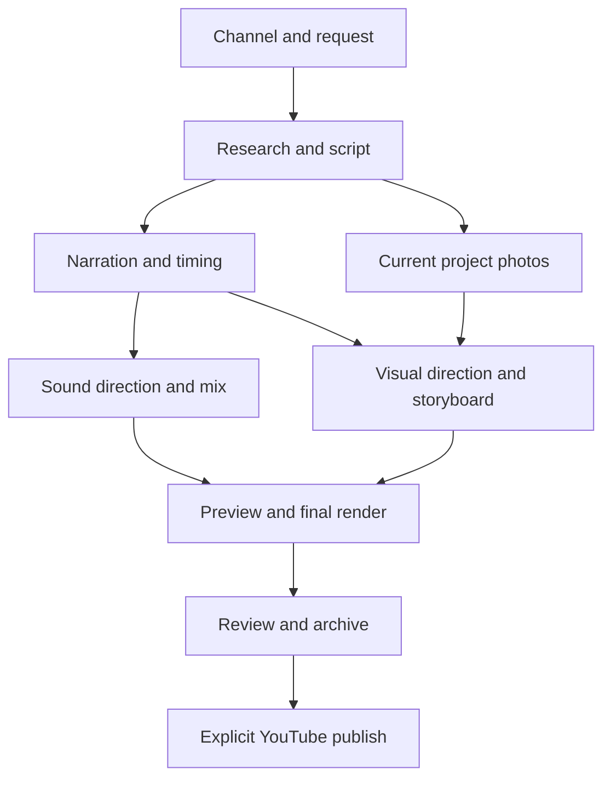

# Pipeline map, agent authority and revision safety

This map describes the workflow in this release and the boundaries preserved while improving it. The original stock-photo pipeline and Classic renderer remain available. Channel identity, measured narration and saved publishing edits are authoritative; a creative agent cannot rewrite them as a side effect of a visual or sound request.

## 1. Production stages

The diagram shows dependencies, not parallel execution. The worker executes in a fixed order: preparation, research, script plus editorial checks, optional images, narration, timing, sound, visuals, video, packaging and archive. Images are skipped for graphics-only Motion. A partial job reuses verified upstream artifacts. Scheduling invokes the same worker in a separate job workspace and restores the open editor afterward.

| Stage | Responsible code | Reads | Writes and checks |
| --- | --- | --- | --- |
| Request and reservation | `studio/pipeline.py`, `profile_context.py`, `project_identity.py` | Selected operation, topic, channel, settings, optional expected storyboard revision | Captures one profile/settings snapshot; validates topic/step combination and owner; reserves the job under a lock. A stale Review revision fails before the worker starts. |
| Preparation | `studio/preflight.py` | Effective steps and mode | Checks FFmpeg/ffprobe, Python dependencies and the pinned Node/browser renderer where needed. An absent binary stops the run with its fix, before source artifacts are replaced. |
| Research | `agents/researcher.py`, `apis/grounding.py` | Topic/angle/channel and available source excerpts | `research.json`, source links and warnings. Retrieved background is not an independent verification of breaking news. A successful new research result invalidates the previous script and dependent media. |
| Writing and editing | `agents/scriptwriter.py`, `agents/script_editor.py`, `agents/json_utils.py` | Research, tone, format and requested length | Provider JSON mode plus complete-object/schema validation before `script.json` is committed. One bounded replacement may recover an invalid script; malformed editorial replies keep the original. Stable section IDs and app-calculated writing estimates feed `quality_review`. News keeps its original factual narration and receives suggestions; the local rubric cannot prove semantic/factual equivalence. |
| Photos, when requested | `video/stock.py`, `apis/images.py`, `studio/visual_assets.py` | Current script's section queries and explicit photo policy | Project-local files, `image_map.json`, credits and a source binding for new maps. Pure Motion does not fetch, discover or attach photos. |
| Narration | `video/narrator.py` | Spoken text, voice, rate, pitch and engine version | Original PCM narration, captions and timing metadata. Verified unchanged section recordings can be reused from atomic cache bundles. Partial failure/cancellation cannot replace the original recording with an incomplete assembly. |
| Timing | `video/timeline.py` | Script and actual recording | `timeline.json`: recording hash, script signature, measured section boundaries, available speech word events, dimensions and frame rate. Legacy SRT/duration estimates are identified as such. |
| Sound direction | `agents/audio_director.py`, `apis/audio_sources.py` | Current narration sections, channel tone/intensity, owned audio catalogue | One music or ambience bed and a sparse cue plan. AI selects search terms/owned IDs and section anchors; trusted code resolves files and timestamps. No model-supplied URL, shell command or arbitrary timestamp is executed. |
| Mixing and finishing | `video/audio_levels.py`, `video/music.py`, `video/sound_effects.py`, `video/audio_master.py`, `studio/runner.py` | Clean narration, resolved recordings, measured duration | Automatic source level matching and transient onset trimming, then a staged mix, immutable `soundtracks/<id>.wav` and atomic v2 `render_audio.json`. The manifest includes its byte hash, credits, actual design and measured mastering report. |
| Visual planning | `agents/visual_director.py`, `agents/art_direction.py`, `agents/object_direction.py` | Script, timeline, source-bound media and channel style | `scene_plan.json`: template, composition, look, grounded illustrated subjects, motion rhythm, labels, constrained media and beats. The model cannot change narration duration or supply executable HTML/JS. Charts require supplied data. |
| Local preview | `video/renderers/html.py`, renderer templates | Exact saved plan and prepared soundtrack | Local `motion/` HTML/SVG/GSAP and copied assets. The preview has restricted browser capabilities and no remote script/media fetching. All model text is inert text. |
| Render and validate | `video/renderers/html.py`, Classic `video/creator.py` | Saved composition, actual recording and requested output mode | A temporary MP4 is checked before replacement. Motion checks dimensions, frame rate, audio and tail duration. `studio/workspace.py` binds the completed render to source fingerprints. |
| Packaging and archive | `studio/description.py`, `studio/library.py` | Current output plus publishing edits | Description, required applied-audio credits, thumbnail and portable archive. Rerendering preserves user prose; only the clearly marked managed audio-credit block is refreshed. |
| Publish | `studio/upload.py`, `uploader/youtube.py` | Reviewed final file, saved project owner and verified channel connection | A separate explicit upload. Drafts, stale storyboards and wrong-channel requests are refused. Schedules do not publish automatically. |

## 2. What an edit invalidates

| User action | Recomputed | Preserved |
| --- | --- | --- |
| New topic | Research, script, narration, timeline, sound, visuals and output | Channel defaults, channel-owned source libraries and archived projects |
| Rewrite script | Narration and all downstream media; new image queries when requested | Research and channel identity |
| Change recorded voice | Narration, timing and dependent sound/visual output | Script and explicitly current project photos |
| Change one scene | That scene's supported visual data, staged HTML and a new draft MP4 | Other scenes, recording, measured clock, prepared soundtrack, thumbnail and publishing prose |
| Rebuild as Motion graphics | A graphics-only storyboard and draft | Current script and recording; legacy source pictures remain stored but are not attached |
| Rebuild animation + sound | New illustrated Motion storyboard, sound choices/mix and draft | Current script, recording, measured timing, owner and publishing prose; old scene designs are intentionally replaced |
| Animate these photos | Explicit photo-capable storyboard and draft | The old pipeline's current project pictures, recording, source credits and timing provenance |
| Regenerate sound design | Agent choices, source acquisition as needed, mix, finishing and draft | Script, original voice, storyboard and publishing prose |
| Render draft/final only | MP4 from the exact saved plan and prepared audio | All creative choices and recordings; no fresh model, stock search or narration call |
| Open archive/restart | Validated in-memory state and local preview if needed | Portable media, source binding, edits and owner; incomplete/stale outputs are not advertised as ready |

The invalidation rules live beside the worker rather than in model prompts. A model cannot decide that old files are safe merely because they have familiar names.

## 3. Why a Review edit is visible

1. Review submits the selected scene and the exact `expected_plan_revision` currently displayed.
2. The server checks the revision and reserves editing. The director interprets the request through supported fields. A freeform instruction that cannot be interpreted leaves the plan intact and produces an explanation. A changed planning note alone is not a visible change.
3. The updated HTML and plan are prepared in a staging directory. They replace the old preview only after preparation succeeds. The response identifies actual changed fields.
4. Old MP4 pointers and QA are cleared. The browser immediately displays the new HTML revision and requests a replacement draft bound to that plan revision.
5. Rendering consumes that exact plan. The resulting MP4 URL changes with the completed file revision. Review seeks to the selected scene; an older asynchronous response cannot replace a newer editor state.

Successful rendering alone is not enough evidence of a successful edit. Verification must also compare the plan, actual frames and the loaded browser URL. Unsupported or unchanged instructions must not be disguised as a successful arbitrary template switch.

## 4. Graphics, media and variety

Hyperframes is the deterministic renderer, not the creative agent. Previously, the visual model primarily chose a template and short labels, while one shared visual theme supplied nearly every frame. The current director also chooses a coherent look and purposeful composition.

| Choice | Purpose |
| --- | --- |
| Editorial | Light surfaces and clear typographic hierarchy for context and reporting |
| Blueprint | Technical grid/line treatment for mechanisms and processes |
| Studio | Restrained dark presentation for a general explanation |
| Botanical | Quiet natural palette and soft movement for calm material |
| Poster | Strong contrast and typographic emphasis for concise ideas |

Compositions (`default`, `split`, `stack`, `focus`) apply to supported explain/text/flow layouts. Rhythm changes bounded entrances and emphasis, never scene lengths or speech-event boundaries. Old plans without these fields retain their original appearance. Topic-derived local choices are deterministic: rerendering the same saved project does not restyle it randomly.

New or explicitly rebuilt scenes have `graphics_version: 2`. A whole-film
creative brief supplies a consistent palette; each scene specifies grounded
actors and roles, a supported world/action and camera framing. The deterministic
world renderer composes those actors together and animates the stated mechanism
on the same paused narration timeline. It does not generate geographic maps,
infer quantities or substitute an old picture. Unknown subjects use a labeled
abstract diagram. Existing version-1 scenes keep their earlier appearance until
explicitly rebuilt. The [scene-direction update](SCENE_DIRECTION_UPDATE.md)
documents the exact capabilities, media selection and checks.

Pure Motion has an explicit `use_project_photos=false` policy and rejects attached photos/footage at validation. Hybrid and the explicit old-photo workflow can use current project media. New image bindings join profile, script, ordered map and file fingerprints. An invalid binding is not permission to scan a folder for an old `section_01` picture. Classic retains its explicit legacy compatibility path.

Hybrid video searches now use the existing Pixabay key as well as Pexels.
Concrete subject metadata is an admission gate; theme and sampled color only
rank admitted clips. Each bounded acquisition verifies decoded frames, measured
dimensions, duration and framing. Its receipt binds the asset to the script,
channel, scene and exact bytes. Used credits come from active scene references,
not an accumulating download ledger. Archive restoration verifies the original
receipt before moving its path into the current project.

The optional frame critic receives early/late pairs for at most three sampled
scenes, plus their stated intent, actors and action. One bounded free-model call
can flag irrelevant generic icons, empty stages, clipping and weak visible
development. It remains opt-in; local-only routing does not send frames remotely,
and still images cannot prove smooth animation or factual accuracy.

## 5. Sound decisions and the meaning of music settings

**Automatic** is the default for a new profile. The sound agent chooses a bed/ambience and sparse effects itself, using available free inference. No file import is required. Compatible requests first use the small included collection of real CC BY 4.0 music and effects; the manifest validates hashes, duration, source and license. Automatic copies remain channel-owned. Other requests use keyless Commons acquisition filtered to declared CC0, Public Domain or CC BY recordings. This searches existing recordings; it does not synthesize arbitrary new audio or audition tracks with an audio-understanding model.

A music candidate also needs positive instrumental/musical metadata and must not
declare speech or vocals. A rain recording cannot become music merely because a
model requested the music category. Literal acoustic terms are extracted from the
AI's artistic instruction before searching; instrumental exclusions are enforced
independently. At most three subject-preserving searches and three distinct remote
downloads share a 45-second deadline. Unreadable or unsuitable candidates do not
prevent the next variant. Transport errors and rate limits do not trigger broader
searches. Specific instruments, materials and negative constraints cannot silently
receive an unrelated included recording. Metadata filtering improves selection but
does not establish the recording's acoustic quality.

**Manual** preserves an existing selected track or effect. On upgrade, an old enabled setting with an explicit imported selection remains Manual. An empty music switch does not prove that there is a playable file. Switching explicitly to Automatic is persisted so migration cannot undo it. **Off** removes added layers while retaining the original recording; optional finishing is a separate setting.

Automatic source preparation measures narration and recording levels, limits gain
and peak, and trims leading silence from one-shot effects before aligning their
cue. Bed/effect ratios are applied after this calibration, with speech ducking.
Manual ratios retain their existing behavior. This stage is separate from final
soundtrack mastering and never modifies the source recording.

The app reports actual applied layers. If no compatible included, cached or remote recording can be used, narration-only audio remains possible, with an explanation in Review. It must never display “music applied” solely because a checkbox or AI proposal requested it. The proposal is separately labeled and collapsed; the applied summary is derived from successful layers. News omits transient effects; calm/ASMR omits sudden accents and uses quieter finishing. The standard finishing targets are −16 LUFS/−1.5 dBTP, and ASMR −20 LUFS/−2 dBTP, with bounded gain. A peak-limited or quiet recording may not reach the target; the report shows the measured result rather than asserting success.

Every sound pass is staged. The previous soundtrack is never overwritten in place. The authoritative manifest changes only after the new audio and its metadata are complete; cancellation preserves the previous committed revision. Video-only renders reuse that committed soundtrack and verify its hash. Archives remap the manifest to their portable audio copy without changing its bytes.

Applied credits are bound to the current recording and soundtrack, survive reopening, and are refreshed before upload. Review's copy/download credit controls expose the same canonical block used in the description. Credits are not cut off to fit a description; a length problem produces an actionable message.

## 6. Free inference and skills

Writing, editorial review, sound direction and text visual planning can use an installed local Ollama model. Local-only does not fall through to cloud, including visual inference. Installed local weights are verified; cloud aliases and automatic model pulls are refused. Hosted Gemini/Groq require appropriate free-tier accounts and remaining quota. OpenRouter uses its free router or a verified free variant. Provider keys alone do not establish an account's billing tier.

The old unauthenticated Pollinations generation assumption is removed. No new paid provider is silently substituted. Missing free inference is an explicit failure for writing and an explicit local fallback for supported visual/audio decisions.

Each worker owns an ephemeral provider-health session. Failed shared text-agent
providers are skipped by later stages of that same video, with a fresh health
record for the next job. Failures are scoped to provider/credential/model and do
not change saved settings. Per-request cloud retry budgets and transport timeouts
bound fallback work; local-only routing and its longer cancellable timeout are
preserved. Direct OpenRouter visual JSON/frame adapters retain their separate
free-only validation and quota controls.

The pinned Hyperframes package already contains relevant motion, explainer, media and review skills. Consult [Agent capabilities](AGENT_CAPABILITIES.md) for exact paths and the extension contract. Installing another skill cannot make an unsupported schema field render. A new capability needs instructions, validation, actual renderer behavior, edit semantics and representative frame checks.

## 7. Verification boundaries

The live event stream records server emission time, run/channel identity, stage
and the captured running build where available. Every browser has its own cursor
over the bounded 1,000-event journal; reconnecting can replay retained messages
without consuming another tab's log. Events from a different run/channel do not
complete the current stream. A history gap is reported explicitly. Scheduled
events keep their original identity after the interactive editor is restored.

The narration log names every recorded/reused section and reports the assembled
section count and measured duration. The worker reports timing and visual-planning
boundaries, including actual illustrated/picture/footage scene counts. An AI
attempt is distinguished from a successful response. These diagnostics describe
the executed flow; they do not turn retrieved sources or successful encoding into
a claim of factual or creative approval.

Tests use controlled provider responses to verify ownership, timing, failure paths and free routing. Real FFmpeg tests exercise mixing, cue placement, duration and loudness. Browser checks exercise actual Flask routes, revision changes, isolation, seeks and layout. Real MP4 tests verify the media handoff separately from mocked provider behavior.

These checks do not establish that every free model writes a good script, every Commons search finds appropriate audio, every TTS service is online, or a given upload will receive views. Live provider availability and content judgment remain distinct from pipeline correctness. The comparison report records the exact tested scope and outstanding competitive gaps.
