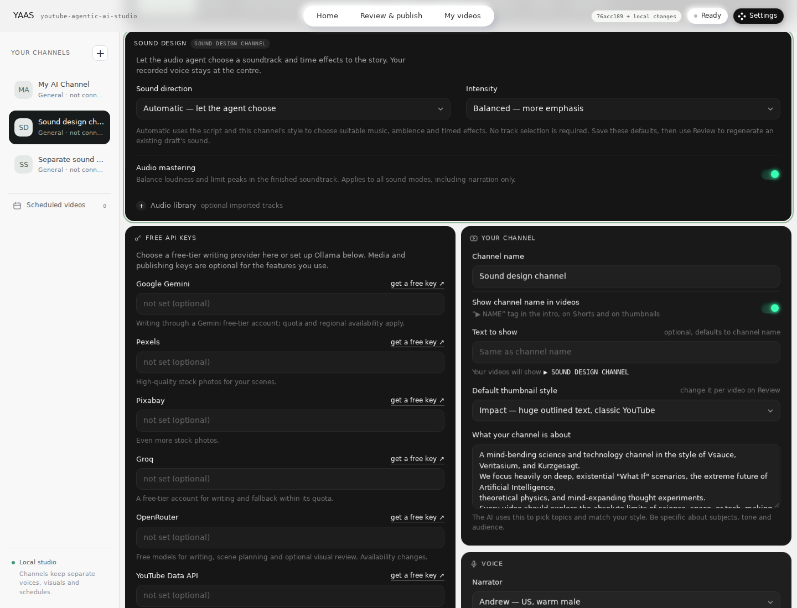

# Follow-up release audit

Rechecked on 8 November 2026 after the report that **Automatic — let the agent
choose** could not be found. This audit supplements the
[pipeline map](PIPELINE_ARCHITECTURE.md),
[repository comparison](REPOSITORY_COMPARISON.md), and
[agent capability map](AGENT_CAPABILITIES.md).

## What was actually published

The previous release was present on `main` at
[`76acc189`](https://github.com/al3ahel/youtube-agentic-ai-studio/commit/76acc18949ca1408842c359f74e06b350d6143e4).
A separate checkout of that exact commit was launched with the real Flask app,
its static files, and its settings API. The Automatic selector existed and saved
for both the default profile and a separate channel. The original handoff did
not establish which checkout or Python process was serving the user's port 8765.

The report nevertheless exposed real omissions. On the published UI, the sound
selector began about 1,371 pixels down a 1440 × 1000 desktop page and about 2,445
pixels down a 390 × 844 mobile page. Settings lost its text label on mobile.
There was no direct Sound design entry on Home, and Review linked to the top of
Settings. A backend mastering preference also had no corresponding UI control.
The earlier test results did not cover these usability and integration gaps.

## Confirmed gaps and corrections

| Area | Reproduced problem | Correction and regression evidence |
|---|---|---|
| Finding sound controls | The selector existed but was far below the first screen; Review did not open its section. | Sound design is the first Settings panel. Home and Review link to `#settings/audio`; named section navigation preserves ordinary `#settings`. Mobile keeps the Settings label. Real browser tests use the actual settings API. |
| Audio mastering | `AUDIO_MASTERING` was accepted by the backend but omitted from the Settings controls and boolean collection. | Added **Audio mastering** and included it in per-channel load, save, undo, reload, and profile-switch checks. |
| Legacy profile migration | The profile display migrated an existing selected track to Manual, while captured runtime overrides could independently default that same channel to Automatic. | Runtime overrides now use the same resolved profile defaults as the display. Tests cover the unsaved migrated profile, actual settings API, and worker dispatch. |
| Leaving a missing manual selection | A full Settings form sent its retained manual asset ID even after selecting Automatic or Off. A deleted file made that save fail. | Validate newly selected assets and active Manual layers; allow a retained unused missing file when leaving Manual. Re-enabling the missing Manual layer still reports the problem. Tests import and remove real owned WAV files for both profile types and both audio layers. |
| Free provider recovery | A configured OpenRouter key took precedence for visual planning, but its failure could skip an available Gemini/Groq provider and go straight to local templates. | A failed selected planner now tries the configured alternate free text chain once, excluding the failed OpenRouter route. Successful selected OpenRouter behavior, cancellation, and Local-only routing are preserved. The plan records the provider that actually answered. |
| Reusing a saved soundtrack | A missing current-voice v2 soundtrack could bypass verification and silently downgrade a video-only rerender to narration, replacing its audio receipt. | A missing, nonlocal, changed, or unverifiable v2 soundtrack stops rerendering with an instruction to apply sound design again. Explicit sound regeneration remains the repair path and preserves the original voice and storyboard. |
| Queued channel sound policy | A scheduled run captured its channel settings, but sound planning could reread the profile's newer live preset after an edit. | Sound direction uses the captured effective channel preset and description. Live profile access remains for ownership/library validation. A queued ASMR regression verifies that later profile changes do not introduce transient effects. |
| Old process on port 8765 | The launcher could schedule a browser opening before discovering that an older process already occupied the port. | Bind the port before starting the browser timer or scheduler. A collision exits with an actionable message and never kills the other process. A real occupied socket is covered by the startup test. |
| Knowing which code is running | The browser did not identify its serving build or distinguish pulled code from Python already loaded by an older process. | A build badge and diagnostic dialog show running and checkout identities. Executable file fingerprints detect a required restart. Web API writes return a clear 409 until restart; viewing and Stop remain available. Missing diagnostics on an old server also produce restart guidance. |

## Where the controls are now

At port 8765, open
[Sound design](http://127.0.0.1:8765/#settings/audio).
Select the intended channel, choose **Automatic — let the agent choose** under
**Sound direction**, and save. **Audio mastering** is independent of added music
or effects. Existing drafts need **Review → Sound design → Regenerate sound
design** to apply new preferences; saving a preference does not silently replace
an already rendered video.

[Mobile Sound design screenshot](screenshots/settings-sound-mobile.png)

## Compatibility map rechecked

| Existing behavior | Main implementation boundary | Regression coverage |
|---|---|---|
| Classic pipeline and old photos/voice | `studio/runner.py`, `video/timeline.py`, workspace/archive readers | `test_legacy_timeline.py`, `test_cached_workspace.py`, `test_motion_pipeline.py`, `test_channel_archive.py` |
| Pure Motion, Hybrid, and intentional legacy photo reuse | `agents/visual_director.py`, `studio/visuals.py`, project identity and asset binding | `test_visual_director.py`, `test_visual_assets.py`, `test_project_identity.py`, `test_motion_pipeline.py` |
| Topic-directed styles and meaningful scene edits | `agents/art_direction.py`, `agents/visual_director.py`, Hyperframes renderer | `test_art_direction.py`, `test_motion_studio.py`, renderer/browser tests |
| Draft readiness, new-video Home, and refreshed render | Review/workspace lifecycle and frontend preview/render state | `test_review_readiness.py`, `test_project_lifecycle.py`, `test_motion_pipeline.py`, real browser edit/render regression |
| Measured narration timing and preserved voice | `video/timeline.py`, voice cache, soundtrack receipt | `test_timeline.py`, `test_voice_cache.py`, `test_audio_preview.py`, `test_motion_pipeline.py` |
| Automatic/Manual/Off sound, mastering and credits | Audio director, library, source adapter, mixer, mastering and metadata | `test_audio_director.py`, `test_sound_migration.py`, `test_audio_library.py`, `test_audio_sources.py`, `test_sound_pipeline.py`, `test_audio_master.py`, `test_audio_metadata.py` |
| Channel isolation and captured schedule defaults | Channel resolver, profile context, scheduler payloads | `test_channel_profiles.py`, `test_schedules.py`, `test_sound_migration.py`, `test_audio_director.py`, real browser profile-switch tests |
| Free cloud fallback and installed local models | `agents/gemini_client.py`, `apis/llm.py`, OpenRouter/Ollama adapters | `test_llm_free_only.py`, `test_llm_routing.py`, `test_local_llm.py`, `test_visual_openrouter.py`, `test_art_direction.py` |
| Startup, build identity and existing request protection | `gui.py`, `studio/build_info.py`, security and profile hooks | `test_build_info.py`, `test_security.py`, `test_app.py`, browser diagnostic tests |

## Validation scope and limits

The corrective release passed **1,088 Python tests** and **33 renderer/browser
tests**, with **zero skips** in both full gates. These include real FFmpeg/Chromium
media checks. Targeted reproductions above were added where the earlier coverage
missed behavior. Browser checks exercise the real Flask settings save/reload
path, per-channel isolation, direct section routes, and small-screen layout.

The commands were `python -m pytest -q` at the repository root and `npm test`
inside `renderers/hyperframes`, with the installed test browser explicitly
configured. Screenshots were captured from the tested working tree before its
release commit; the badge correctly labels it as the previous commit plus local
code changes. On an updated clean checkout, the badge identifies the new commit.

Provider success/failure and queued-job edge cases use controlled responses.
They demonstrate routing and state handling; they do not demonstrate live model
quality, unlimited free quotas, or a successful live audio-source download. The
checks run in the development Linux environment, not on the user's Windows
computer. No live YouTube upload or channel replacement is part of this audit.

The restart guard applies to the web API in this release. An already running
older process cannot acquire the guard without restarting. Scheduler-only and
CLI processes must also be stopped and restarted when updating. The build badge
identifies local code changes separately from a Git commit and supports ZIP
installs with a content fingerprint; it is a local diagnostic, not an automatic
updater or a remote release comparison.

For exact PowerShell commands using `.venv-yaas312` and port 8765, see
[Upgrading from an earlier checkout](../SETUP.md#upgrading-from-an-earlier-checkout).
