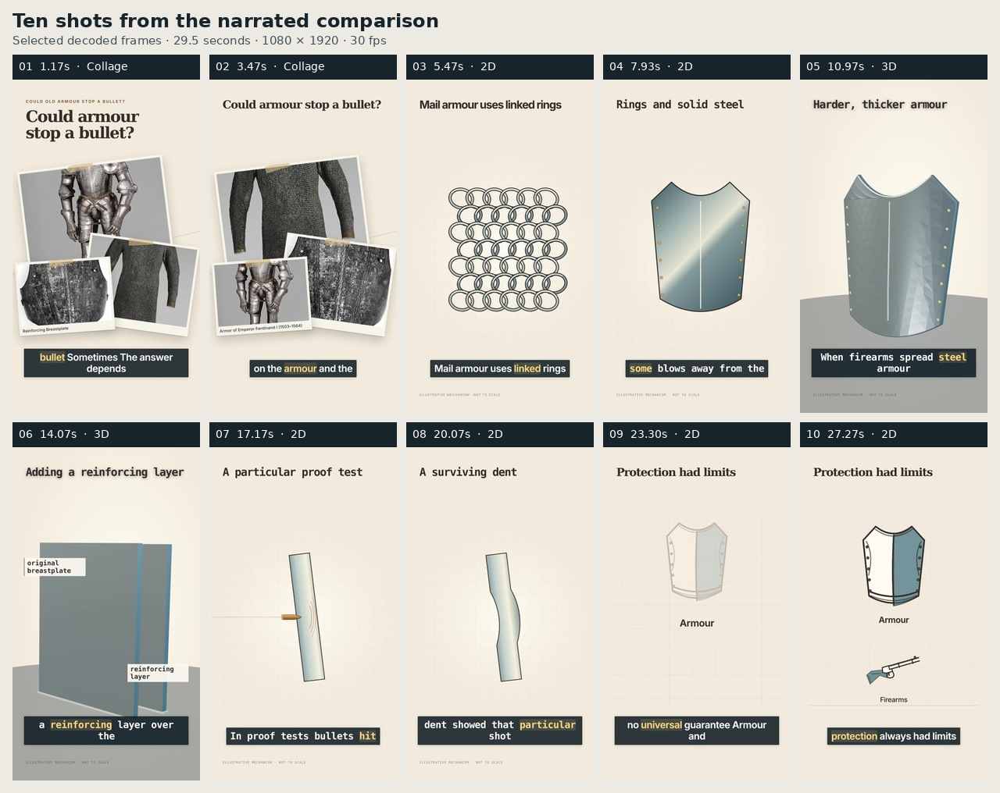

# Armour versus bullets: real pipeline comparison

This is a complete, narrated **29.5-second film produced through the real local-model pipeline**, followed by inspection-directed storyboard edits and a fresh encoded review. The strict semantic review **did not approve the result**: `comparison_complete` is `false`, and the final status is `rendered_needs_review`. The film, actual model replies and failed review criteria are retained together.

**[Watch the film](video.mp4)** · **[View the ten-shot overview](overview.jpg)** · **[Inspect all 30 decoded phase samples](contact-sheet.jpg)** · **[Compare the repaired failures](before-after.jpg)**



## What was actually produced

| Item | Observed result |
| --- | --- |
| Output | H.264 video with AAC audio; 1080 × 1920, 30 fps, 885 decoded frames, 29.5 seconds |
| Topic | Whether historical armour could stop a bullet, with qualifications about the armour, weapon and particular test |
| Narration | The complete original 84-word script; free network Edge TTS, `en-US-AndrewNeural`, rate `+14%` |
| Local model | Ollama 0.40.15, `qwen3.5:4b`, 4.2B Q4_K_M; the full installed-model digest is recorded in the provenance |
| Planning | Ten shots across five measured narration sections; four genuine fresh local planning requests |
| Actual scene mix | Two museum-photo collages, six 2D shots and two genuine Three.js 3D shots |
| Automatic sound | The normal sound director selected a licensed *Cylinder One* music bed and one generic metal-contact accent at 4.6 seconds |
| Images | Three verified public-domain Metropolitan Museum of Art assets, with their original identities and credits |

The 2D scenes include linked mail rings, a plate impact and its retained dent. The 3D views expose plate depth and the relationship of a reinforcing layer to the original plate. Footage composition is implemented and tested elsewhere in the renderer; **this particular film contains no footage**.

The model was selected through a run-only configuration override. Saved profile defaults were preserved. The user's separate Windows installation and credentials were not available in this execution environment. Edge TTS used a network service; this was not an entirely offline run.

## Reference match and limits

The chosen reference is Artem Novitckii's [“Could ancient armour stop a bullet?” animation example](https://github.com/artemnovitckii/claude-animation-skills/tree/5dbea55c23aa6a5c93dc3cfb5583840513b56b94/skills/zach-d-films). Its source declares a 29.49-second timeline and documents the portrait output workflow. At 30 fps, the nearest complete frame count is 885 frames, or 29.5 seconds: a 0.01-second difference.

Only the author's [3.6-second silent public excerpt](https://novitckii.com/lib/animation-skills/zach-d-films.mp4) was accessible as an actual reference movie. The 29.49-second target therefore comes from the pinned source timeline, not a measurement of an available full-length reference encode. There is **no claim of full-length playback comparison, matching reference sound, or quality parity**. The exact URLs, source timing and excerpt hash are in [reference.json](reference.json).

## What the review and repair loop did

The original fresh plan received ten model scene proposals. Seven were accepted and retained non-text choices consumed by the renderer; three were rejected by structural or source-grounding guards. The resulting encoded sequence was inspected, and four normal local-model editor requests corrected concrete findings:

- **Shot 005:** replaced a repeated frontal plate view with a medium 3D orbit that exposes depth; the heading became “Harder, thicker armour.” This view does not simulate hardening.
- **Shot 007:** changed an overly broad heading to “A particular proof test.”
- **Shot 008:** changed the heading to “A surviving dent” while retaining the already-correct settled dent. One candidate also changed heading size and was rejected; a bounded model retry preserved it correctly.
- **Shot 010:** replaced unsupported deflection/strike labels with the source nouns “Armour” and “Firearms,” retaining their geometry and staging.

These were **inspection-directed editorial choices carried out through the ordinary `regenerate_scene` model path**. They were not hand-patched scene JSON or unsolicited original model decisions. Five actual editor responses, including the rejected candidate, are preserved in [editorial-repair.json](editorial-repair.json) and the raw captures.

General renderer repairs also replaced narration fragments in photo captions with trusted image identities, suppressed rear identity captions while their text bounds are occluded, and preserved a source-derived settled dent without firing a second projectile. The caption-occlusion repair changes visible pixels in shots 001/002 even though their plan objects stayed identical. “Other shots preserved” refers to their plan objects, film clocks and recordings, not universal pixel identity across renderer versions.

The final re-encode retained the same narration and mixed soundtrack. Its decoded native-rate AAC PCM is byte-identical to the preceding fresh movie: SHA-256 `b4027aa9fbf3f3f21d394ed41da74d5a3095cbb987f13bcd6de29f892df8c6cb`, 11,329,536 bytes. Normal label editing recomputed the target actors' reveal/highlight beats in shot 010; those changes are separately recorded rather than described as unchanged animation timing.

## Final review result: not approved

The final ordinary review ran to completion with the production bound of one possible repair. It decoded all ten shots at three phases each and made ten real local vision requests.

| Review evidence | Final count or status |
| --- | --- |
| Technical shot coverage | 10 of 10 shots; 30 decoded frames |
| Completed local vision requests | 10 |
| Replies with accepted evidence shape | 8 |
| Reliable complete passes | 1: the bullet approach/contact/dent shot 007 |
| Accepted but unreliable replies | 7, because at least one assessment remained uncertain |
| Rejected inconsistent replies | 2: shots 003/008 marked a category failed without an evidenced issue for that category |
| Automatic repair authority | None from the remaining replies; `repair_history` is empty |
| Strict semantic coverage | Incomplete |
| Final review | `passed: false`, `status: issues_found` |
| Comparison acceptance | `comparison_complete: false`, `status: rendered_needs_review` |

The model often recognized the pictured subjects yet demanded a new physical event from a hold or settled result. It also called the rotating 3D plate samples identical. Those replies remain visible and unchanged; uncertainty was not converted into approval. [visual-qa.json](visual-qa.json) is the actual normal report. [review-response-validation.json](review-response-validation.json) records a read-only repeat of the unchanged evidence validator against the captured replies, including the two inconsistent responses.

Independent assistant frame inspection confirmed the requested repairs and retained limits: the mail and plate shots 003/004 remain held explanatory views, the 3D plate is faceted and shows depth rather than a hardening transformation, and shot 009 has faint emphasis. One reviewer inspected all 30 individual samples; another inspected 13 samples across the ten shots; root inspected the overview/contact sheet. These records do not override the local-model gate or claim every-frame playback review.

Encoded audio measurements found no silence or clipping issue in the normal checks. Audio was **measured, not listened to**; there is no subjective sound-quality or intelligibility approval. The final model chose a construction accent at 4.6 seconds. The earlier proof-contact timing defect and its corrected measured-word resolver are documented separately in [audio-timing-audit.json](audio-timing-audit.json); that retrospective audit is not a claim that the final film selected a proof-impact sound.

## Evidence and provenance

The final MP4 SHA-256 is `a8cc826624ba496307f5baebd6445de92712b6197164a1f4bca1a3b0d2c0f290` (7,831,583 bytes).

- [comparison.json](comparison.json) contains the actual final gates and unmet requirements.
- [scene-plan.json](scene-plan.json) contains the portable final plan; [packaging-provenance.json](packaging-provenance.json) records its exact path-only differences from the original reviewed plan. Original and portable canonical hashes are deliberately different. The duplicate plan beside the decoded frames is explicitly identified as another portable copy.
- [model-responses.json](model-responses.json) indexes 22 byte-identical copies of the retained, capture-time-redacted responses: fresh planning/sound, the interrupted preceding review, editorial candidates and the complete final review. The older sound response used only for the timing audit is separate.
- [narration-coverage.json](narration-coverage.json) binds all 84 ordered returned word events to the script and narration; it is not ASR or a listening assessment.
- [credits.json](credits.json) contains museum and audio attribution. Museum objects are illustrative, not a claim that those exact objects were bullet-tested. The metal recording is generic contact foley, not an authenticated armour test or gunshot.
- [before-after.json](before-after.json), [independent-inspection.json](independent-inspection.json), [additional-frame-review.json](additional-frame-review.json) and [overview.json](overview.json) bind the visual inspections to actual frame/movie hashes.
- [prior-attempts.json](prior-attempts.json) keeps failed and interrupted attempts distinct from this final editorial run.
- [validation.json](validation.json) records the 1,659-test Python gate and browser checks, with the exact source fingerprints and subsequent focused checks for the final renderer/reviewer corrections. Test coverage is not a substitute for decoded semantic approval.

## Run the normal comparison pipeline

With the project dependencies, FFmpeg, HyperFrames browser and local Ollama model available, run from the repository root:

```bash
python renderers/hyperframes/comparable_demo.py --render --local-model qwen3.5:4b
```

Use `--prepare-only` to stop before encoding, or `--resume` to reuse verified matching narration/assets. The harness records actual providers and blocks unmet gates; it does not silently substitute deterministic planning for model inference. It does not upload to YouTube. New model/service calls may produce different results. This sample film includes the separately recorded inspection-directed editor operations described above, followed by the normal production encoder and review path.
